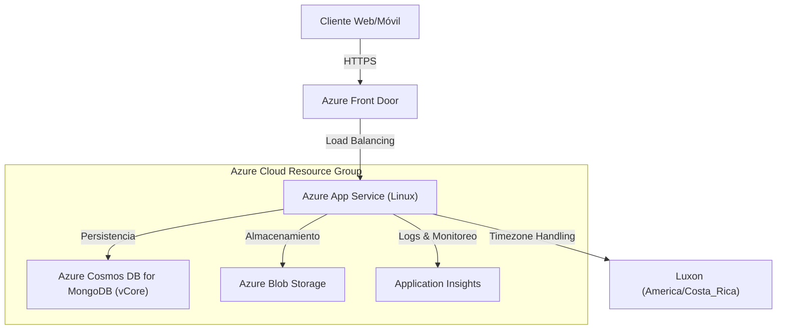
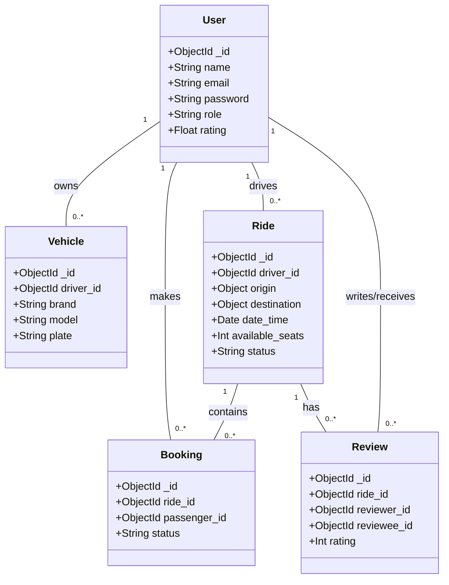

# Safe-Ride Backend API


[](https://nodejs.org/)
[](LICENSE)

Backend robusto y escalable para la plataforma de carpooling **Safe-Ride**, diseñado para facilitar el transporte compartido corporativo y universitario, reduciendo la huella de carbono y optimizando la movilidad urbana.

## 📋 Tabla de Contenidos

- [Descripción del Proyecto](#-descripción-del-proyecto)
- [Caracteristicas](#-características)
- [Arquitectura e Infraestructura](#-arquitectura-e-infraestructura)
- [Tecnologías Utilizadas](#-tecnologías-utilizadas)
- [Estructura del Proyecto](#-estructura-del-proyecto)
- [Base de Datos](#-base-de-datos)
- [API Endpoints](#-api-endpoints)
- [Instalación y Configuración](#-instalación-y-configuración)
- [Testing](#-testing)
- [Despliegue](#-despliegue)
- [Colaboración](#-colaboración)
- [Contacto](#-contacto)

---

## 📖 Descripción del Proyecto

Safe-Ride es una solución tecnológica que conecta a conductores con asientos disponibles y pasajeros que se dirigen al mismo destino. El backend gestiona toda la lógica de negocio, incluyendo:

- **Gestión de Usuarios:** Perfiles de conductores y pasajeros, autenticación segura.
- **Viajes (Rides):** Creación, búsqueda geoespacial y gestión de estados de viajes.
- **Reservas (Bookings):** Sistema de solicitud y confirmación de asientos.
- **Seguridad:** Validación de vehículos y licencias.
- **Gamificación y Métricas:** Cálculo de ahorro de CO2 y kilómetros compartidos.
- **Notificaciones:** Alertas en tiempo real sobre el estado de los viajes.

## ✨ Características

### Autenticación y Usuarios
- ✅ Registro de usuarios con validación completa
- ✅ Login con JWT (Access Token y Refresh Token)
- ✅ Autenticación con Azure Active Directory (Entra ID)
- ✅ Gestión de perfiles de usuario (conductores, pasajeros, administradores)
- ✅ Actualización de contraseña segura
- ✅ Subida de imágenes de perfil a Azure Blob Storage

### Gestión de Viajes
- ✅ Creación de viajes con origen, destino y horarios
- ✅ Búsqueda y filtrado de viajes disponibles
- ✅ Sistema de asientos disponibles
- ✅ Estados de viaje: programado, en progreso, completado, cancelado
- ✅ Geolocalización con coordenadas lat/lng

### Sistema de Reservas
- ✅ Reserva de asientos en viajes
- ✅ Gestión de estados: pendiente, confirmado, cancelado, completado
- ✅ Prevención de reservas duplicadas
- ✅ Validación de capacidad de asientos

### Vehículos
- ✅ Registro de vehículos con validación de placa
- ✅ Gestión de información: marca, modelo, año, color, capacidad
- ✅ Subida de imágenes de vehículos
- ✅ Asociación conductor-vehículo

### Reseñas y Calificaciones
- ✅ Sistema de reseñas entre usuarios
- ✅ Calificación de 1 a 5 estrellas
- ✅ Comentarios y feedback

### Notificaciones
- ✅ Sistema de notificaciones en tiempo real
- ✅ Notificaciones de reservas, confirmaciones y cancelaciones
- ✅ Estados: no leída, leída, archivada

### Métricas y Análisis
- ✅ Dashboard de métricas del sistema
- ✅ Estadísticas de usuarios, viajes y reservas
- ✅ Análisis de uso por empresa

### Seguridad
- ✅ Autenticación JWT con tokens de acceso y actualización
- ✅ Encriptación de contraseñas con bcrypt
- ✅ Helmet.js para headers de seguridad
- ✅ Rate limiting para prevenir abuso
- ✅ CORS configurado
- ✅ Validación de datos con express-validator
- ✅ Integración con Azure Key Vault

## 🏗 Arquitectura e Infraestructura

El sistema está construido sobre una arquitectura monolítica modular desplegada en la nube de **Microsoft Azure**.

### Diagrama de Infraestructura



### Componentes Clave

- **Azure App Service:** Hospeda la aplicación Node.js en un entorno Linux.
- **Azure Cosmos DB (vCore):** Base de datos NoSQL compatible con MongoDB para almacenamiento de alto rendimiento.
- **Azure Front Door:** CDN y balanceador de carga global para baja latencia y seguridad.
- **Azure Blob Storage:** Almacenamiento de imágenes de perfil y vehículos.

## 🛠 Tecnologías Utilizadas

### Core

- **Runtime:** [Node.js](https://nodejs.org/) (v18+)
- **Framework:** [Express.js](https://expressjs.com/) (v5.0)
- **Lenguaje:** JavaScript (ES6+)

### Base de Datos & ODM

- **Mongoose:** Modelado de objetos para MongoDB.
- **MongoDB / Azure Cosmos DB:** Base de datos principal.

### Seguridad & Utilidades

- **JWT (JsonWebToken):** Autenticación stateless.
- **BcryptJS:** Hashing de contraseñas.
- **Helmet & CORS:** Seguridad de cabeceras HTTP.
- **Express Validator:** Validación de datos de entrada.
- **Luxon:** Manejo preciso de zonas horarias (UTC vs Local).
- **Multer:** Manejo de subida de archivos (imágenes).

### Documentación & Testing

- **Swagger (OpenAPI 3.0):** Documentación interactiva de la API.
- **Jest:** Framework de pruebas unitarias y de integración.

## 📂 Estructura del Proyecto

```bash
saferide-backend/
├── coverage/                      # Reportes de cobertura de tests (generado)
│   ├── clover.xml
│   ├── coverage-final.json
│   ├── lcov.info
│   └── lcov-report/
│       ├── base.css
│       ├── block-navigation.js
│       ├── index.html
│       ├── prettify.css
│       ├── prettify.js
│       ├── sorter.js
│       └── src/                  # Reportes detallados por archivo
│           ├── app.js.html
│           ├── config/
│           ├── controllers/
│           ├── events/
│           ├── jobs/
│           ├── middleware/
│           ├── models/
│           ├── routes/
│           ├── services/
│           ├── utils/
│           └── workers/
├── public/                        # Archivos estáticos públicos
│   ├── code-examples.html        # Ejemplos de código de la API
│   ├── docs.html                 # Documentación adicional
│   └── safe-ride-logo-inverted.png
├── src/                           # Código fuente principal
│   ├── app.js                    # Configuración principal de Express
│   ├── swagger-spec.json         # Especificación OpenAPI generada
│   ├── config/                   # Configuraciones del sistema
│   │   ├── auth.js              # Configuración JWT y autenticación
│   │   ├── azure.js             # Clientes de Azure (Blob, KeyVault)
│   │   ├── database.js          # Conexión a Cosmos DB/MongoDB
│   │   └── swagger.js           # Configuración de Swagger/OpenAPI
│   ├── controllers/              # Controladores de lógica de negocio
│   │   ├── authController.js    # Autenticación (login, register, refresh)
│   │   ├── bookingController.js # Gestión de reservas
│   │   ├── metricsController.js # Métricas y estadísticas
│   │   ├── notificationController.js # Notificaciones
│   │   ├── reviewController.js  # Reseñas y calificaciones
│   │   ├── rideController.js    # Creación y gestión de viajes
│   │   ├── userController.js    # Gestión de usuarios
│   │   └── vehicleController.js # Gestión de vehículos
│   ├── events/                   # Sistema de eventos
│   │   └── eventEmitter.js      # Event emitter personalizado
│   ├── jobs/                     # Tareas programadas (Cron Jobs)
│   │   ├── calculateMetrics.js  # Cálculo de métricas de sostenibilidad
│   │   ├── cleanupExpiredRides.js # Limpieza de viajes expirados
│   │   ├── index.js             # Exportación de jobs
│   │   ├── scheduledJobs.js     # Configuración de jobs programados
│   │   └── sendRideReminders.js # Envío de recordatorios de viajes
│   ├── middleware/               # Middleware personalizado
│   │   ├── auth.js              # Autenticación y autorización JWT
│   │   ├── errorHandler.js      # Manejo centralizado de errores
│   │   ├── rateLimiter.js       # Rate limiting para prevenir abuso
│   │   └── validation.js        # Validación de datos de entrada
│   ├── models/                   # Modelos de datos (Mongoose)
│   │   ├── Bookings.js          # Modelo de reservaciones
│   │   ├── Metics.js            # Modelo de métricas
│   │   ├── Notification.js      # Modelo de notificaciones
│   │   ├── Review.js            # Modelo de reseñas
│   │   ├── Ride.js              # Modelo de viajes
│   │   ├── User.js              # Modelo de usuarios
│   │   ├── Vehicle.js           # Modelo de vehículos
│   │   └── index.js             # Exportación de modelos
│   ├── routes/                   # Definición de rutas de la API
│   │   ├── authRoutes.js        # Rutas de autenticación
│   │   ├── bookingRoutes.js     # Rutas de reservas
│   │   ├── metricsRoutes.js     # Rutas de métricas
│   │   ├── notificationRoutes.js # Rutas de notificaciones
│   │   ├── reviewRoutes.js      # Rutas de reseñas
│   │   ├── rideRoutes.js        # Rutas de viajes
│   │   ├── userRoutes.js        # Rutas de usuarios
│   │   ├── vehicleRoutes.js     # Rutas de vehículos
│   │   └── index.js             # Router principal
│   ├── scripts/                  # Scripts de utilidad y mantenimiento
│   │   ├── generate-postman.js  # Generación de colección Postman
│   │   └── initDatabase.js      # Inicialización de base de datos
│   ├── services/                 # Servicios de lógica de negocio
│   │   ├── blobService.js       # Servicio de Azure Blob Storage
│   │   ├── metricsService.js    # Cálculos de métricas
│   │   └── notificationService.js # Gestión de notificaciones
│   ├── tests/                    # Tests unitarios e integración
│   │   ├── auth.tests.js        # Tests de autenticación
│   │   └── setup.js             # Configuración de tests
│   ├── utils/                    # Utilidades generales
│   │   ├── logger.js            # Logger personalizado con Winston
│   │   ├── responseHelper.js    # Helpers para respuestas HTTP
│   │   └── timeZone.js          # Manejo de zonas horarias con Luxon
│   └── workers/                  # Workers para procesamiento asíncrono
│       └── notificationWorker.js # Worker de notificaciones con Bull
├── .eslintrc.js                  # Configuración de ESLint
├── .gitignore                    # Archivos ignorados por Git
├── jest.config.js                # Configuración de Jest para testing
├── package.json                  # Dependencias y scripts npm
├── package-lock.json             # Lock file de dependencias
├── postman-collection.json       # Colección de Postman (generado)
├── README.md                     # Este archivo - Documentación
├── server.js                     # Punto de entrada de la aplicación
└── swagger-spec.json             # Especificación OpenAPI (generado)
```

## 🗄 Base de Datos

El modelo de datos está diseñado para ser flexible y escalable. A continuación se presenta un diagrama entidad-relación simplificado de las colecciones principales.

### Diagrama de Clases / Entidades



## 🔌 API Endpoints

La documentación completa e interactiva está disponible en `/api-docs` cuando el servidor está en ejecución.

### Resumen de Módulos

### Base URL

```
http://localhost:8080/api/v1
```

### Autenticación (`/auth`)

| Método | Endpoint | Descripción | Auth |
|--------|----------|-------------|------|
| POST | `/auth/register` | Registrar nuevo usuario | No |
| POST | `/auth/login` | Iniciar sesión | No |
| POST | `/auth/refresh` | Refrescar access token | No |
| POST | `/auth/logout` | Cerrar sesión | Sí |
| GET | `/auth/me` | Obtener usuario actual | Sí |
| PUT | `/auth/password` | Actualizar contraseña | Sí |

### Usuarios (`/users`)

| Método | Endpoint | Descripción | Auth |
|--------|----------|-------------|------|
| GET | `/users` | Listar usuarios | Sí (Admin) |
| GET | `/users/:id` | Obtener usuario por ID | Sí |
| PUT | `/users/:id` | Actualizar usuario | Sí |
| DELETE | `/users/:id` | Eliminar usuario | Sí (Admin) |
| POST | `/users/:id/profile-image` | Subir imagen de perfil | Sí |

### Vehículos (`/vehicles`)

| Método | Endpoint | Descripción | Auth |
|--------|----------|-------------|------|
| POST | `/vehicles` | Registrar vehículo | Sí (Conductor) |
| GET | `/vehicles` | Listar vehículos | Sí |
| GET | `/vehicles/:id` | Obtener vehículo por ID | Sí |
| PUT | `/vehicles/:id` | Actualizar vehículo | Sí (Conductor) |
| DELETE | `/vehicles/:id` | Eliminar vehículo | Sí (Conductor) |
| POST | `/vehicles/:id/image` | Subir imagen de vehículo | Sí (Conductor) |

### Viajes (`/rides`)

| Método | Endpoint | Descripción | Auth |
|--------|----------|-------------|------|
| POST | `/rides` | Crear viaje | Sí (Conductor) |
| GET | `/rides` | Listar viajes disponibles | Opcional |
| GET | `/rides/:id` | Obtener viaje por ID | Opcional |
| PUT | `/rides/:id` | Actualizar viaje | Sí (Conductor) |
| DELETE | `/rides/:id` | Cancelar viaje | Sí (Conductor) |
| GET | `/rides/driver/:driverId` | Viajes de un conductor | Sí |
| PATCH | `/rides/:id/start` | Iniciar viaje | Sí (Conductor) |
| PATCH | `/rides/:id/complete` | Completar viaje | Sí (Conductor) |

### Reservas (`/bookings`)

| Método | Endpoint | Descripción | Auth |
|--------|----------|-------------|------|
| POST | `/bookings` | Crear reserva | Sí (Pasajero) |
| GET | `/bookings` | Listar mis reservas | Sí |
| GET | `/bookings/:id` | Obtener reserva por ID | Sí |
| PUT | `/bookings/:id` | Actualizar reserva | Sí |
| DELETE | `/bookings/:id` | Cancelar reserva | Sí |
| PATCH | `/bookings/:id/confirm` | Confirmar reserva | Sí (Conductor) |

### Reseñas (`/reviews`)

| Método | Endpoint | Descripción | Auth |
|--------|----------|-------------|------|
| POST | `/reviews` | Crear reseña | Sí |
| GET | `/reviews/user/:userId` | Reseñas de un usuario | Sí |
| GET | `/reviews/:id` | Obtener reseña por ID | Sí |
| PUT | `/reviews/:id` | Actualizar reseña | Sí |
| DELETE | `/reviews/:id` | Eliminar reseña | Sí |

### Notificaciones (`/notifications`)

| Método | Endpoint | Descripción | Auth |
|--------|----------|-------------|------|
| GET | `/notifications` | Listar mis notificaciones | Sí |
| GET | `/notifications/:id` | Obtener notificación | Sí |
| PATCH | `/notifications/:id/read` | Marcar como leída | Sí |
| DELETE | `/notifications/:id` | Eliminar notificación | Sí |

### Métricas (`/metrics`)

| Método | Endpoint | Descripción | Auth |
|--------|----------|-------------|------|
| GET | `/metrics/dashboard` | Dashboard de métricas | Sí (Admin) |
| GET | `/metrics/users` | Estadísticas de usuarios | Sí (Admin) |
| GET | `/metrics/rides` | Estadísticas de viajes | Sí (Admin) |


## 🚀 Instalación y Configuración

### Prerrequisitos

- Node.js v18 o superior.
- Instancia de MongoDB (Local o Atlas/Cosmos DB).
- Cuenta de Azure Storage (opcional para imágenes).

### Pasos

1.  **Clonar el repositorio:**

    ```bash
    git clone https://safe-ride-app@dev.azure.com/safe-ride-app/Safe-RideApp/_git/saferide-backend
    Ingresar las credenciales para clonar el proyecto
    cd saferide-backend
    ```

2.  **Instalar dependencias:**

    ```bash
    npm install
    ```

3.  **Configurar variables de entorno:**
    Crea un archivo `.env` en la raíz basado en el siguiente ejemplo:
    ```env # Server Configuration
        NODE_ENV=production
        PORT=8080
        API_VERSION=v1

        # Azure Cosmos DB

        COSMOS_ENDPOINT=https://cosmos-endpoint
        COSMOS_KEY=Cosmos-Key
        COSMOS_CONNECTION_STRING=cosmos-mongodb-connection-string
        COSMOS_DATABASE=name-of-the-database

        # Azure Blob Storage

        BLOB_STORAGE_CONNECTION_STRING=blob-connnection-string
        BLOB_CONTAINER_PROFILE=blob-container-name
        BLOB_CONTAINER_VEHICLE=blob-container-name

        # Microsoft Entra ID (Azure AD)

        ENTRA_TENANT_ID=tenant-id
        ENTRA_CLIENT_ID=client-id
        ENTRA_CLIENT_SECRET=client-secret
        ENTRA_REDIRECT_URI=http://uri-entra-id

        # JWT Configuration

        JWT_SECRET=jwt-secret
        JWT_EXPIRES_IN=24h
        JWT_REFRESH_EXPIRES_IN=7d

        # Application Insights

        APPLICATIONINSIGHTS_CONNECTION_STRING=connection-string-for-application-insights

        # Rate Limiting

        RATE_LIMIT_WINDOW_MS=##
        RATE_LIMIT_MAX_REQUESTS=##

        # CORS

        CORS_ORIGIN=cors-origin-of-the-database

        # Azure Key Vault (Optional)

        KEY_VAULT_URL=https://key-vault-url

        APP_TIMEZONE=America/Costa_Rica
    ```

4.  **Inicializar base de datos (opcional):**

    ```bash
    npm run db:init
    ```

5.  **Iniciar el servidor:**
    ```bash
    npm run dev  # Modo desarrollo
    npm start    # Modo producción
    ```

## 🧪 Testing

El proyecto utiliza **Jest** para pruebas automatizadas.

```bash
# Ejecutar todos los tests
npm test

# Ejecutar tests con cobertura
npm test -- --coverage
```

## ☁️ Despliegue

El despliegue de la aplicacion esta automatizado por medio de GitHub Actions, todo merge realizado en el main branch desde un branch autorizado realizara el despliegue.

## 🤝 Colaboración

¡Las contribuciones son bienvenidas! Por favor sigue estos pasos:

1.  Haz un Fork del repositorio.
2.  Crea una rama para tu feature (`git checkout -b feature/AmazingFeature`).
3.  Commit a tus cambios (`git commit -m 'Add some AmazingFeature'`).
4.  Push a la rama (`git push origin feature/AmazingFeature`).
5.  Abre un Pull Request.

## 📞 Contacto

**Jose Pablo Muñoz Carvajal** - _Lead Developer_

- Email: [safe-ride-app@hotmail.com](mailto:safe-ride-app@hotmail.com)
- GitHub: [@jmunozc023](https://github.com/jmunozc023)

---

© 2025 Safe-Ride. Todos los derechos reservados.

