<p align="center">
  
</p>

<h1 align="center">SafeRide</h1>

<p align="center">
  Carpooling corporativo para Costa Rica: compañeros de una misma empresa comparten el viaje al trabajo,
  pagan menos y reducen tráfico y emisiones.
</p>

<p align="center">
  
  
  
  
  
</p>

---

## Qué es SafeRide

SafeRide conecta a **conductores** que tienen asientos libres con **pasajeros** de la misma empresa que van al
mismo destino. Solo se registran personas con **correo corporativo** (los correos personales como Gmail o
Hotmail se rechazan), así que cada quien viaja con compañeros de trabajo verificados.

- **El conductor** publica su ruta, la hora y los asientos libres; acepta o rechaza solicitudes; inicia el
  viaje, comparte su ubicación en vivo y, al llegar, confirma quién pagó.
- **El pasajero** busca viajes hacia su destino, ofrece un monto, espera la aceptación, sigue el carro en el
  mapa y paga en efectivo, por SINPE Móvil o (en beta) en línea.
- **Ambos** se califican al terminar, ven su historial y sus métricas de kilómetros compartidos y CO₂ ahorrado.

Este repositorio contiene el proyecto completo:

| Carpeta | Qué es | Tecnología |
|---|---|---|
| [`frontend/`](frontend) | App móvil para Android e iOS | Expo SDK 54, React Native 0.81, React Navigation |
| [`backend/`](backend) | API REST y trabajos programados | Node.js, Express 5, MongoDB (Azure Cosmos DB), Mongoose |
| [`docs/`](docs) | Capturas de pantalla usadas en este README | |

El historial de commits de los dos proyectos originales se conserva completo.

---

## Capturas

Tomadas en un Samsung Galaxy A34 real con Expo Go durante las pruebas de la entrega.

### Registro e inicio de sesión

| Inicio de sesión | Elegir rol | Verificación del correo |
|:---:|:---:|:---:|
| 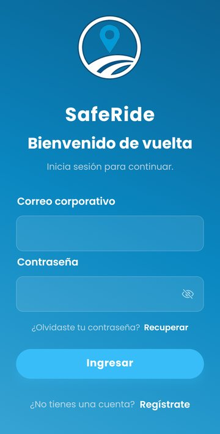 | 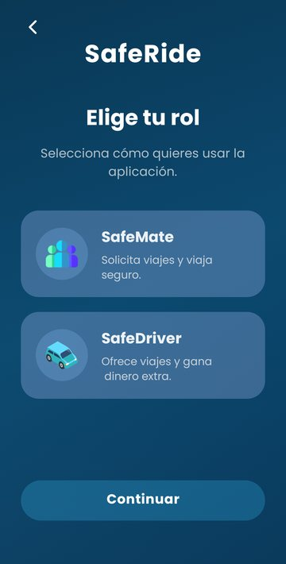 | 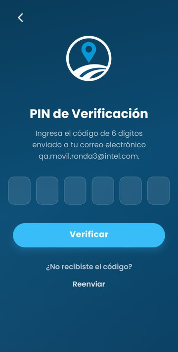 |

### Pasajero: buscar y reservar

| Inicio | Buscar viaje | Autocompletado de destino |
|:---:|:---:|:---:|
| 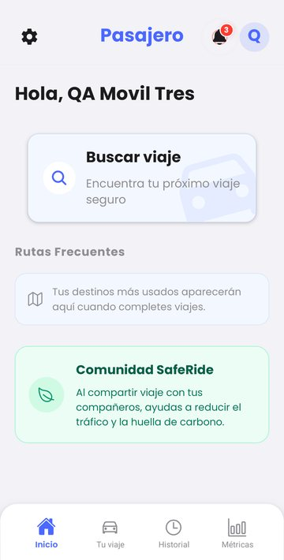 | 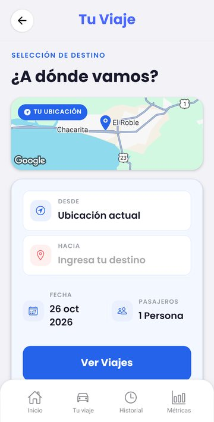 | 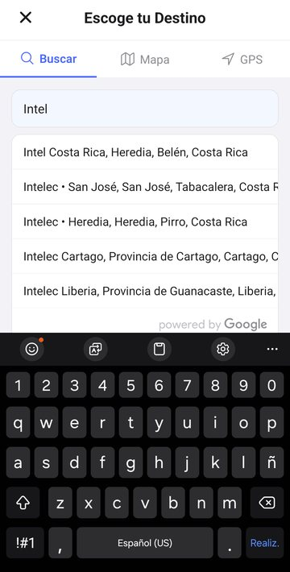 |

| Detalle y oferta | Esperando al conductor | Viaje confirmado |
|:---:|:---:|:---:|
| 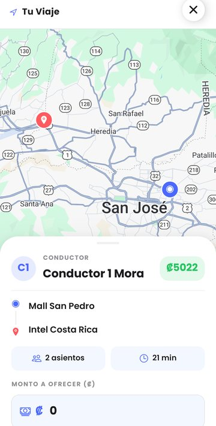 | 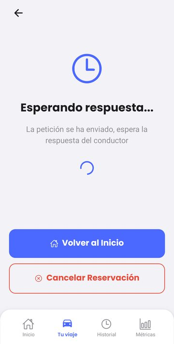 | 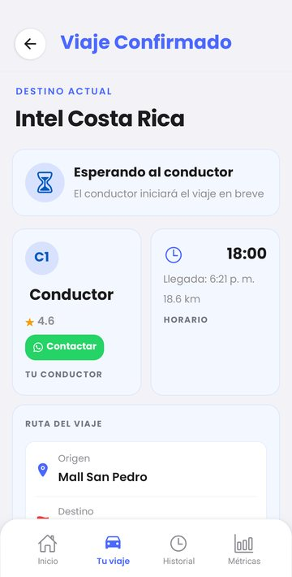 |

### Pasajero: viaje, pago y calificación

| Viaje en curso | Método de pago | Pago con tarjeta (beta) | Calificar |
|:---:|:---:|:---:|:---:|
| 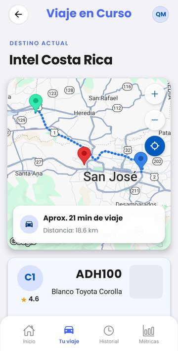 | 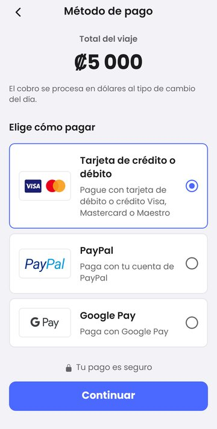 | 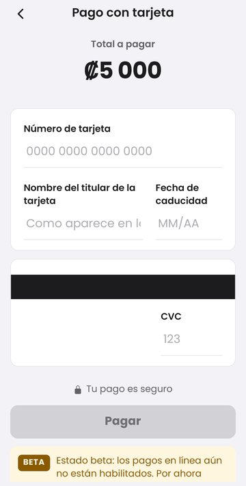 | 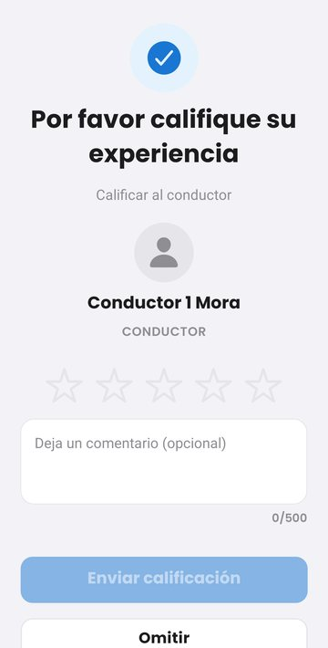 |

### Conductor

| Inicio | Publicar viaje | Viaje en curso | Editar viaje |
|:---:|:---:|:---:|:---:|
| 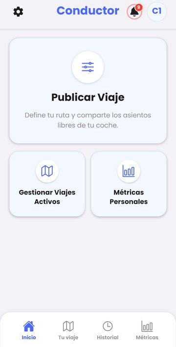 | 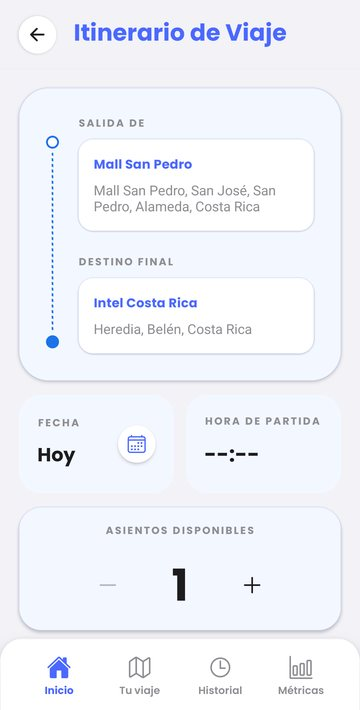 | 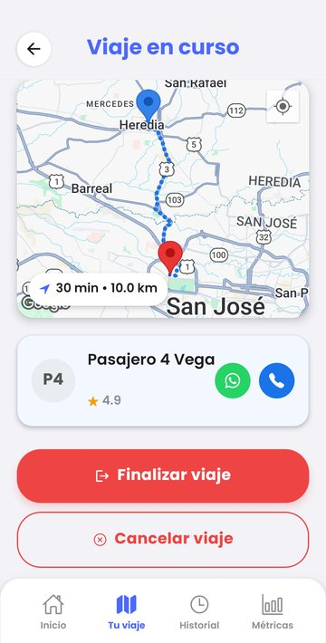 | 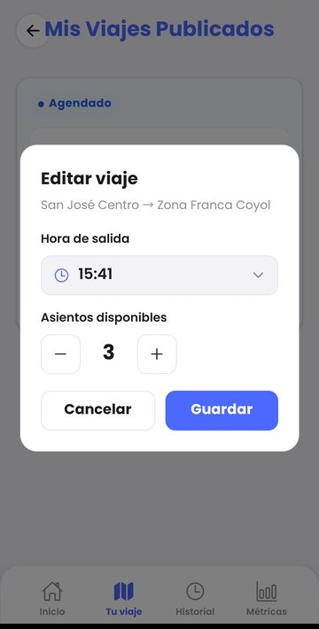 |

### Historial, métricas y cuenta

| Historial del conductor | Métricas | Notificaciones | Modo oscuro | Perfil |
|:---:|:---:|:---:|:---:|:---:|
| 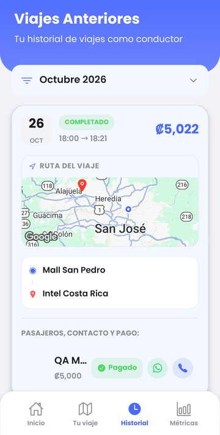 | 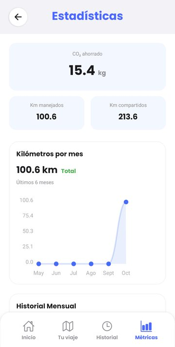 | 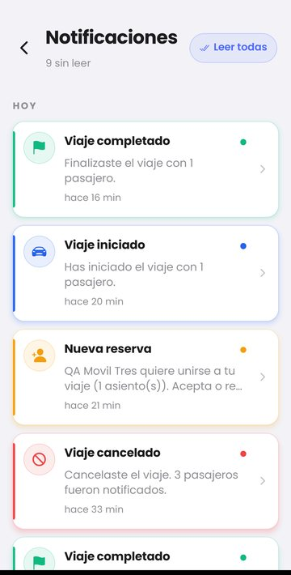 | 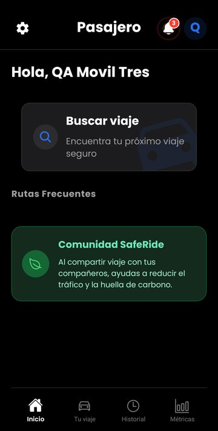 | 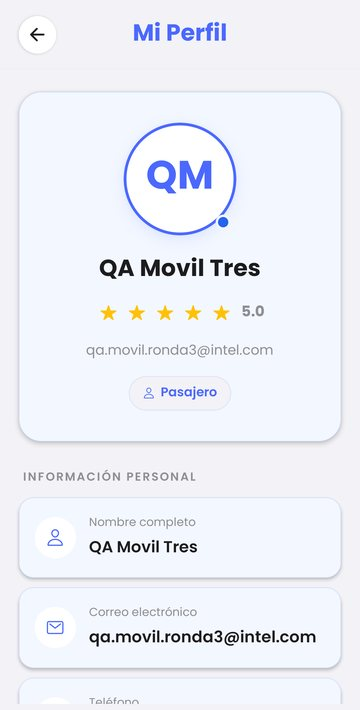 |

---

## Flujo de un viaje

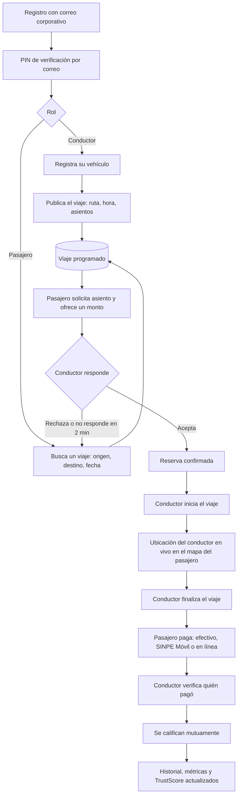

**Estados de una reserva:** `pending` → `confirmed` → `completed`, con salidas a `deny` (el conductor rechaza)
o `cancelled` (el pasajero cancela antes de que el carro salga). Una vez que el viaje inició, una reserva
confirmada ya no se puede cancelar, y quien tiene un cobro pendiente no puede reservar otro viaje hasta pagarlo.

---

## Arquitectura

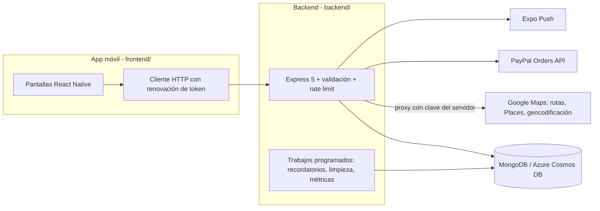

- **Estado en vivo:** las pantallas de espera, de viaje en curso y la ubicación del conductor se actualizan
  consultando la API cada pocos segundos, y se pausan cuando la app pasa a segundo plano.
- **Autenticación:** JWT de acceso (1 h) y de renovación, con rotación y revocación guardando solo el hash
  del token. Límites de peticiones por usuario.
- **Google Maps va por el backend:** la app no lleva en el bundle la clave de rutas, Places ni geocodificación;
  el backend hace de proxy con su propia clave restringida. La app solo usa la clave del SDK nativo del mapa.
- **Pagos:** el efectivo y SINPE Móvil funcionan completos. El pago en línea (PayPal, tarjeta, Apple Pay,
  Google Pay) está construido y probado contra el sandbox de PayPal, pero se entrega en **estado beta**
  detrás de la bandera `ONLINE_PAYMENTS_LIVE` en
  [`PayPalCheckoutScreen.js`](frontend/src/screens/pasajero/PayPalCheckoutScreen.js): se ve el formulario
  y el botón Pagar queda en gris con el aviso de beta.

---

## Estructura

```
saferide/
├── frontend/                 App móvil (Expo)
│   ├── App.js                Navegación: pila de conductor y de pasajero
│   ├── app.config.js         Configuración de Expo y EAS
│   ├── src/screens/          pasajero/, conductor/, register/
│   ├── src/components/       Checkout, mapas, modales, selector de ubicación
│   ├── src/services/         Cliente de la API y servicios por módulo
│   ├── src/context/          Tema claro/oscuro
│   └── __tests__/            Pruebas con Jest
├── backend/                  API REST
│   ├── server.js
│   ├── src/routes/           auth, rides, bookings, reviews, maps, paypal, ...
│   ├── src/controllers/      Lógica de negocio
│   ├── src/models/           Esquemas de Mongoose
│   ├── src/jobs/             Recordatorios, limpieza y métricas programadas
│   ├── src/scripts/          initDatabase.js (datos de prueba)
│   └── scripts/qa/           Pruebas de ataques y de flujos contra la API
└── docs/screenshots/
```

Documentación más detallada de la API en [`backend/README.md`](backend/README.md) y
[`backend/ENDPOINTS.md`](backend/ENDPOINTS.md).

---

## Cómo correrlo en local

Requisitos: Node.js 18 o superior, una base MongoDB (Azure Cosmos DB o local) y la app **Expo Go** del
SDK 54 en el teléfono.

### 1. Backend

```bash
cd backend
cp .env.example .env        # completar COSMOS_CONNECTION_STRING, JWT_SECRET, REFRESH_TOKEN_SECRET, ...
npm install
npm run db:init             # opcional: crea usuarios y viajes de prueba
npm start                   # http://localhost:8080/api/v1
```

Usa una base de pruebas (`COSMOS_DATABASE=...`) distinta de la de producción: `db:init` y los scripts de QA
crean y modifican datos.

### 2. App móvil

```bash
cd frontend
cp .env.example .env        # EXPO_PUBLIC_API_URL puede quedar vacía en desarrollo
npm install
npm start                   # escanear el QR con Expo Go
```

Si `EXPO_PUBLIC_API_URL` queda vacía, en desarrollo la app usa la IP de la PC que sirve Expo en el puerto 8080.
Con el teléfono por USB también funciona `adb reverse tcp:8080 tcp:8080`.

### 3. Pruebas

```bash
cd frontend && npm test             # pruebas unitarias de la app
cd backend  && npm run qa:ataques   # 103 casos: permisos, inyección, carreras, tokens, límites
cd backend  && npm run qa:flujos    # 93 casos: ciclo completo de viaje, reservas, pagos, reseñas
```

Los scripts de QA necesitan el backend corriendo contra la base de pruebas; ver
[`backend/scripts/qa/README.md`](backend/scripts/qa/README.md).

---

## Qué se hizo en la entrega (octubre 2026)

### Funcionalidad terminada
- Checkout de pago con tarjeta, PayPal, Apple Pay y Google Pay, con los colores de SafeRide; el flujo real de
  PayPal funciona en sandbox y se entrega en beta.
- Direcciones, autocompletado de lugares y geocodificación a través del backend, sin claves en la app.
- Listados completos (historial, solicitudes, viajes) sin el límite de 10 resultados.
- Editar un viaje publicado (hora y asientos) y cancelarlo con confirmación en dos pasos.
- Eliminar la cuenta desde la app, como exigen Google Play y App Store; el backend anonimiza los datos y lo
  bloquea si hay viajes activos o cobros pendientes.
- Configuración por entorno y proyecto de EAS listo para generar los binarios.

### Cinco rondas de QA

| Ronda | Qué se probó | Resultado |
|---|---|---|
| 1. Ataques | 103 ataques contra la API: datos con tipos inválidos, acceso a datos de otros usuarios, escritura de ubicación ajena, carreras al reservar el último asiento, tokens falsificados o vencidos, CORS, Swagger expuesto | 103/103 tras los arreglos |
| 2. Flujos | 93 casos del negocio: reservar, aceptar, iniciar, cancelar en cada estado, pagar, verificar pagos, calificar, conflictos de horario, cobros pendientes | 93/93 tras los arreglos |
| 3. Teléfono real | Recorrido completo de pasajero y conductor en un Galaxy A34, incluyendo diseño, modo oscuro y textos | 9 problemas de pantalla arreglados |
| 4. Revisión crítica | Revisión del código desde cuatro perspectivas con una síntesis final | 3 riesgos arreglados antes de la entrega |
| 5. Regresión | Todo lo anterior otra vez con el código final, más pruebas unitarias y compilación del bundle | Sin fallos |

Algunos de los arreglos que salieron de esas rondas:
- La confirmación y la cancelación de reservas son atómicas: dos pasajeros ya no pueden quedarse con el
  mismo último asiento ni descuadrar el conteo.
- Un pasajero que se cansa de esperar ya no puede cancelar por accidente una reserva que el conductor acababa de
  aceptar.
- El backend hace cumplir las mismas reglas que la app: no se publica un viaje con otro en curso, no se reserva
  con un cobro pendiente, solo califica quien viajó.
- Todos los montos se muestran con el mismo formato de colones (`₡5,022`).

---

## Pendiente

Lo que depende de cuentas, credenciales o dinero, y por eso no se activó en esta entrega:

- Pagos en línea en producción: cuenta de comercio de PayPal, tasa de cambio definitiva, Apple Pay y Google Pay.
- Clave de Google Maps de producción para el SDK nativo, restringida al paquete `cr.saferide.app`.
- Backend publicado en la nube con dominio HTTPS.
- Publicación en Google Play y App Store.

Deuda técnica conocida: las pantallas de espera no avisan cuando se pierde la conexión, el tiempo de espera de
una solicitud se calcula con el reloj del teléfono, y todo se probó en Expo Go, no en el binario final de EAS.
